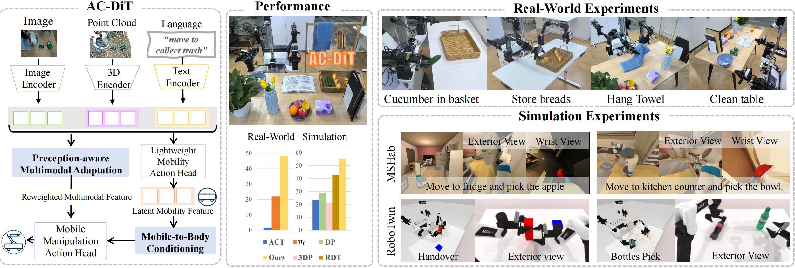

<div align="center">

# AC-DiT: Adaptive Coordination Diffusion Transformer for Mobile Manipulation

[🌐**Website**](https://ac-dit.github.io/) | [📚**arXiv**](https://arxiv.org/abs/2507.01961)

[Sixiang Chen](https://cscsx.github.io/)\*, [Jiaming Liu](https://liujiaming1996.github.io/)\*, [Siyuan Qian](https://siriyep.github.io/)\*, Han Jiang, [Lily Li](https://clorislili.github.io/clorisLi/), [Renrui Zhang](https://zrrskywalker.github.io/), [Zhuoyang Liu](https://zhuoyangliu2005.github.io/), [Chenyang Gu](https://gaystarc.github.io/), [Chengkai Hou](https://jackhck.github.io/), Pengwei Wang, Zhongyuan Wang, [Shanghang Zhang](https://www.shanghangzhang.com)

</div>



**AC-DiT** is a **end-to-end mobile manipulation framework** 🤖, which enhances the coordination between the mobile base and the manipulator by introducing two key mechanisms: mobile-to-body conditioning and perception-aware multimodal adaptation. 

## ✨ News ✨

- [2026/02/23] AC-DiT has gone open source! 🔥
- [2025/09/19] AC-DiT has been accepted by NeurIPS 2025! 🎉
- [2025/07/03] AC-DiT has now been posted on arXiv! 🚀 

## 🔨 Usage 🔨

```bash
# install ManiSkill
cd third_party/ManiSkill
pip install -e . --no-deps

# install mshab
cd ../mshab
pip install -e . --no-deps

# install lift3d
pip install setuptools==69.5.1
cd ../LIFT3D
 pip install -e . --no-deps --no-build-isolation

# install torch
pip install torch==2.7.0 torchvision==0.22.0 torchaudio==2.7.0 --index-url https://download.pytorch.org/whl/cu128

# install pytorch3d (for lift3d)
pip install "git+https://github.com/facebookresearch/pytorch3d.git@stable" --no-build-isolation

# install dependencies
pip install -r requirements.txt

# download assets
for dataset in ycb ReplicaCAD ReplicaCADRearrange; do python -m mani_skill.utils.download_asset "$dataset"; done
hf download arth-shukla/mshab_checkpoints --local-dir mshab_checkpoints

# generate data
cd third_party/mshab
./scripts/gen_single_dataset.sh
python add_pointcloud.py --task set_table --subtask pick --max-workers 16

# generate language embeddings
python -m data.mshab.encode_instructions --dataset-root /share/project/chensixiang/Codes/AC-DiT/third_party/mshab/mshab_data/gen_data_save_trajectories --overwrite

# train mobility-head
python -m scripts.finetune_mshab_base_only

# train AC-DiT
python -m scripts.finetune_mshab_acdit

# evaluate AC-DiT
python -m scripts.eval_mshab \
    --method-name AC-DiT \
    --task set_table \
    --subtask pick \
    --object 013_apple \
    --num-traj 10 \
    --pretrained-path {path_to_the_pretrained_model} \
    --mobility-head-ckpt-path {path_to_the_mobility_head_checkpoint} \
    --dataset-dir {path_to_the_dataset} \
    --result-dir {path_to_the_result_directory} \
    --control-mode pd_joint_delta_pos \
    --overwrite
```

## 📚 BibTeX 📚

```bibtex
@misc{chen2025acditadaptivecoordinationdiffusion,
      title={AC-DiT: Adaptive Coordination Diffusion Transformer for Mobile Manipulation}, 
      author={Sixiang Chen and Jiaming Liu and Siyuan Qian and Han Jiang and Lily Li and Renrui Zhang and Zhuoyang Liu and Chenyang Gu and Chengkai Hou and Pengwei Wang and Zhongyuan Wang and Shanghang Zhang},
      year={2025},
      eprint={2507.01961},
      archivePrefix={arXiv},
      primaryClass={cs.RO},
      url={https://arxiv.org/abs/2507.01961}, 
}
```